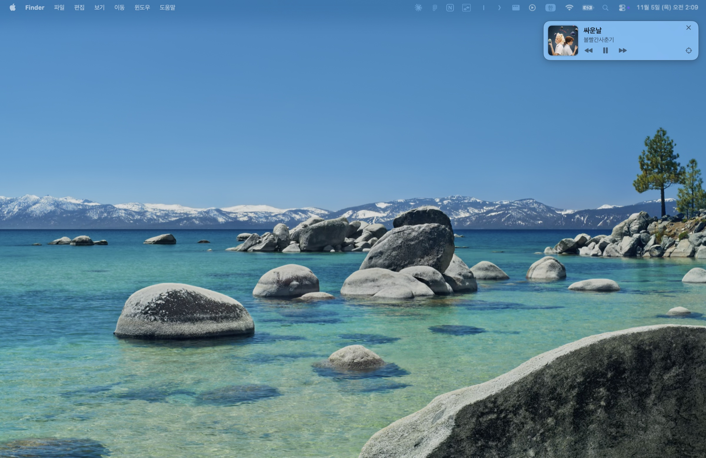
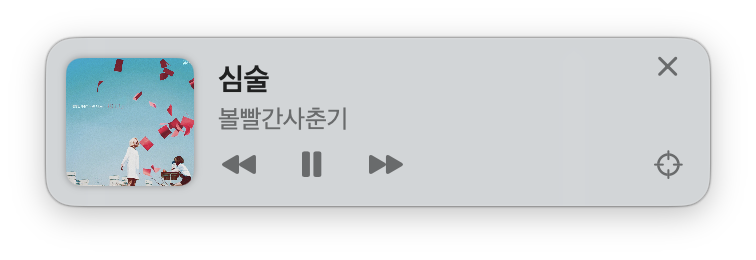

# NowPlaying Widget

[](https://github.com/uuuhyun/nowplaying-widget/actions/workflows/build.yml)

Apple Music에서 지금 재생 중인 곡의 **앨범 커버와 제목**을 화면 구석에 **항상 위에** 띄워 주는 macOS 플로팅 위젯입니다.
Music 앱을 숨겨 두거나 다른 앱을 전체화면으로 써도 무슨 곡이 나오는지 바로 보입니다.

A tiny always-on-top macOS widget that shows Apple Music's current track and album artwork.

<p align="center"></p>

## 기능 / Features

<p align="center"></p>

- 🎵 앨범 커버 · 곡 제목 · 아티스트 실시간 표시 (곡이 바뀌면 즉시 갱신)
- 📌 항상 다른 창 위 — 모든 데스크탑(Space)과 전체화면 앱 위에도 표시
- ⏮ ⏯ ⏭ 재생 컨트롤 버튼
- ⌖ 기본 위치(현재 모니터 우상단)로 되돌리기 · 드래그로 이동, 위치 기억
- ✕ 숨기기 — 재생을 다시 시작하거나 Music을 다시 켜면 자동으로 나타남
- 🚀 Music 앱이 켜져 있을 때만 보이고, 꺼지면 자동으로 숨김
- 🖱 우클릭: 크기(4단계) · 투명도 · 종료
- Dock 아이콘 없음, 폴링 없이 Music 알림 기반이라 가벼움 (Swift 단일 파일)

## 설치 / Install

### A. Homebrew (추천)

```bash
brew install uuuhyun/tap/nowplaying-widget
brew services start nowplaying-widget
```

Homebrew를 쓰고 있다면 빌드에 필요한 도구(Command Line Tools)가 이미 설치돼 있어서 바로 됩니다.

### B. Homebrew 없이 한 줄 설치

처음 한 번 Command Line Tools를 설치한 뒤 (이미 있으면 건너뛰기)

```bash
xcode-select --install
```

설치 스크립트를 실행하세요.

```bash
curl -fsSL https://raw.githubusercontent.com/uuuhyun/nowplaying-widget/main/install.sh | bash
```

### 권한 허용
Music 앱을 켜면 위젯이 나타납니다. 처음 한 번 *"NowPlaying이(가) Music을 제어하려고 합니다"* 창이 뜨면 **허용**을 눌러 주세요.
(실수로 거부했다면 `시스템 설정 → 개인정보 보호 및 보안 → 자동화`에서 켤 수 있습니다.)
로그인 시 자동 실행되므로 *"앱 백그라운드 활동"* 알림이 뜨는 것은 정상입니다.

## 삭제 / Uninstall

```bash
# Homebrew로 설치한 경우
brew services stop nowplaying-widget && brew uninstall nowplaying-widget

# 스크립트로 설치한 경우
curl -fsSL https://raw.githubusercontent.com/uuuhyun/nowplaying-widget/main/uninstall.sh | bash
```

## 요구 사항 / Requirements

- macOS 14 Sonoma 이상 (Apple Silicon · Intel)
- Apple Music 앱 (Music.app)

## 직접 빌드 / Build from source

```bash
git clone https://github.com/uuuhyun/nowplaying-widget.git
cd nowplaying-widget
./install.sh          # 빌드 + ~/Applications 설치 + 자동 실행 등록
```

`--demo` 인자로 실행하면 샘플 곡으로 위젯을 띄웁니다 (스크린샷용).

```bash
~/Applications/NowPlaying.app/Contents/MacOS/NowPlaying --demo
```

## 기여하기 / Contributing

버그 제보·기능 제안·PR 모두 환영합니다! 시작하기 전에 [CONTRIBUTING.md](CONTRIBUTING.md)를 읽어 주세요.
Issues and pull requests are welcome — see [CONTRIBUTING.md](CONTRIBUTING.md).

## License

[MIT](LICENSE)
